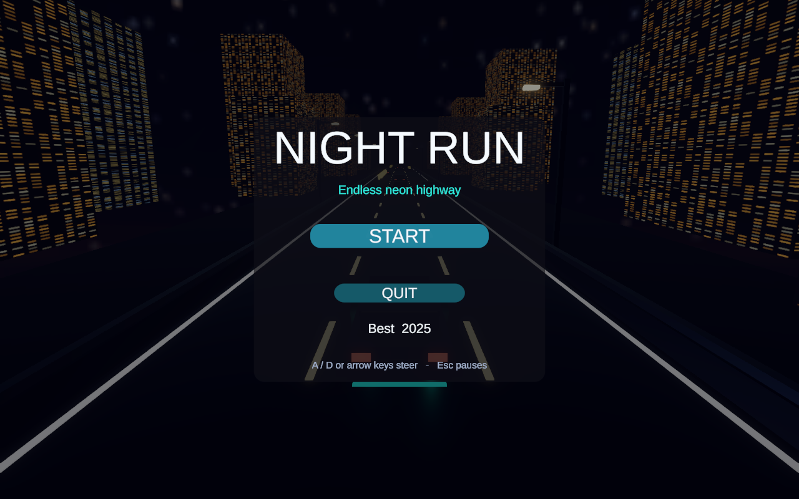
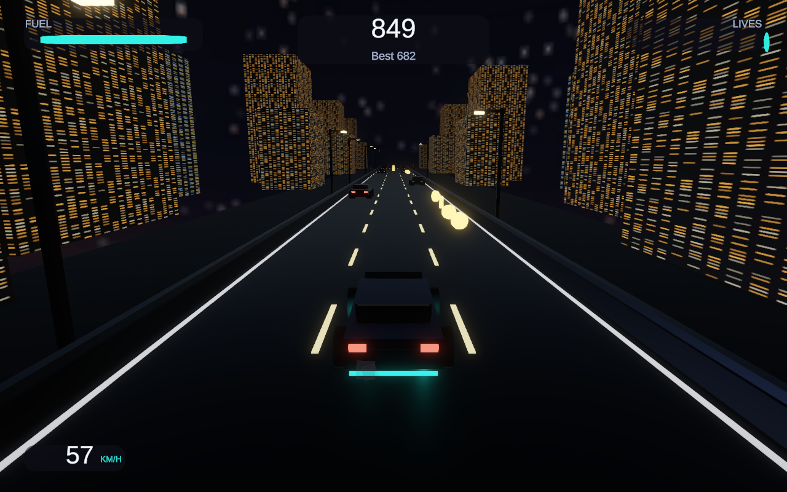
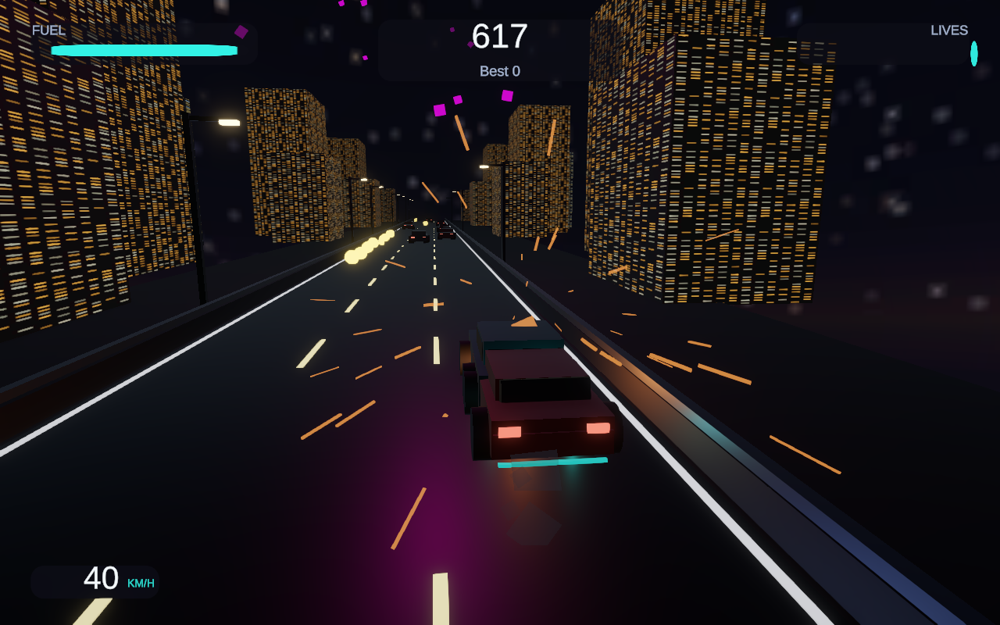
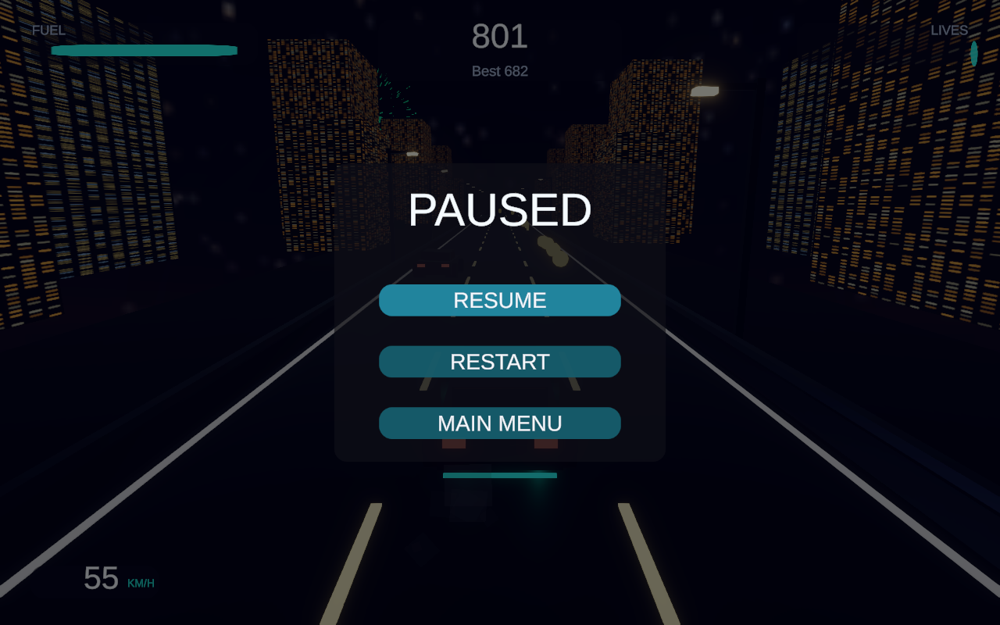
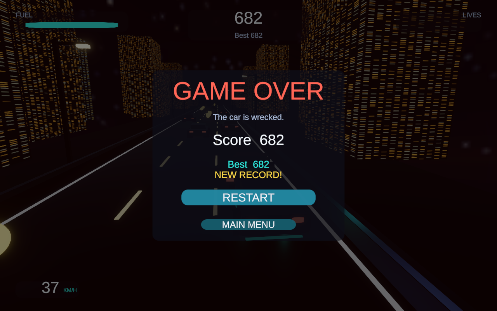
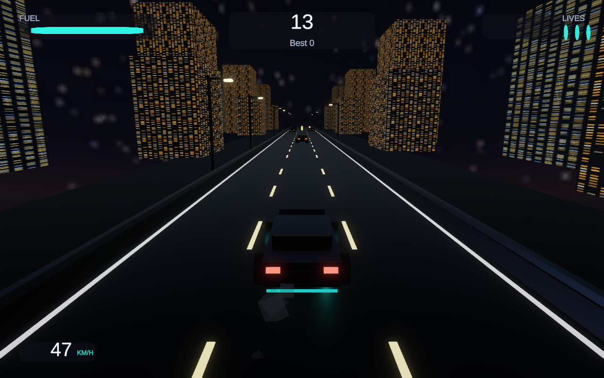

# Night Run — Work Report

Assignment 2 (Endless 3D Car Game), Computer Game Design — Iran University of Science and Industry
Student: Saeed Nourian · 401522196 · Repository: `deliverable/github.txt`

## How the project is assembled

Everything is generated from code. The editor menu **HW2 → Build Game (assets + scene)**
(`Assets/Editor/Hw2SceneBuilder.cs`) runs the procedural art generator (`Hw2Assets.cs`), the
prefab builder (`Hw2Prefabs.cs`) and the scene builder in order, so the whole game can be
rebuilt from an empty folder. **HW2 → Verify Scene Setup** re-checks the resulting scene
(pools, camera rig, event system, volumes, managers) and reports what it finds. Produced
assets stay normal, editable Unity assets (meshes, materials, prefabs, `Game.unity`).

Stack: Unity **6000.6.6f1**, URP 17.6, **Input System 1.20** (old Input Manager is disabled),
TextMeshPro, uGUI 2.6. No third-party gameplay code.

## Implementation structure (`Assets/Scripts`)

### Core (`HW2`)
| Class | Role |
|---|---|
| `Singleton<T>` | Minimal MonoBehaviour singleton base; `GameManager`, `PoolManager`, `InputManager`, `AudioManager`, `Fireworks` derive from it. |
| `GameManager` | **Singleton state machine** `Menu / Playing / Paused / GameOver`. Owns score, lives, fuel, distance, speed ramp and the high score record (`PlayerPrefs` key `HW2.HighScore`, written on a new record). Raises `StateChanged`, `RunStarted`, `RunEnded`, `LivesChanged`, `FuelChanged`, `PlayerHit` events; the UI and the player only react to these. |
| `InputManager` | Sole owner of the generated Input System asset; exposes `Steer`, `PausePressed`, `RestartPressed` and enables/disables the `Gameplay` map with the game state. Nothing else touches devices. |
| `PoolManager` | **Object pooling.** One pool per `PoolKey` (RoadSegment, StaticObstacle, MovingObstacle, Coin, FuelCan, FireworkRocket, FireworkBurst, ImpactSparks, PickupBurst). Rent/Return only; pooled objects implement `IPoolable`. No `Instantiate`/`Destroy` at runtime. |
| `GameSettings` | ScriptableObject in `Resources/` with every tunable (3 lanes × 3.5 m, 9 × 60 m segments, 13→46 m/s ramp over 2 800 m, 3 lives, 100 fuel burning 2.9/s, 42 per can, …). |
| `ThirdPersonCamera` / `CameraShake` | Third-person chase rig that tracks lateral position and pulls back / widens FOV with speed; decaying shake impulse fired on impact. |

### OOP hierarchy (`HW2.Interactables`)
| Class | Role |
|---|---|
| `Interactable` (abstract) | Base of everything met on the road: lane placement, scrolling with the road, trigger detection, recycling into the pool (`IPoolable`), abstract `OnPlayerTouch`. |
| `Obstacle` : `Interactable` | Abstract middle layer — costs a life via `GameManager.RegisterHit`, sets the invulnerability window; visual reaction left to the subclass. |
| `StaticObstacle` : `Obstacle` | **Obstacle type 1** — a broken-down car that only scrolls with the road. |
| `MovingObstacle` : `Obstacle` | **Obstacle type 2** — a car driving in the same direction at a share of road speed, so the player closes in on it. |
| `Collectible` : `Interactable` | Abstract pickup base: reacts even while invulnerable, plays its own fade-out burst. |
| `Coin` : `Collectible` | **Collectible 1** — laid out in lines in a free lane, adds score bonus. |
| `FuelCan` : `Collectible` | **Collectible 2** — refills the tank, which is what keeps the run alive. |

### World (`HW2.World`)
`RoadSpawner` keeps a fixed window of road segments scrolling towards the player and recycles
the ones that fall behind — **procedural, infinite road with no instantiation**.
`RoadSegment` is one recyclable stretch (geometry from the local origin along +Z).
`SpawnDirector` fills a freshly recycled segment: obstacle chance and two-lane blocks grow with
distance, while one guaranteed free lane per row and a fuel can every ~380 m keep it fair.

### Player (`HW2.Player`)
`PlayerCar` — lane steering read from `InputManager.Steer` (A/D, arrows, gamepad stick) with a
0.24 s lane change, body tilt, 1.3 s invulnerability, red damage tint + sparks + shake on hit,
fuel/life reactions, **speed-proportional neon underglow** (emission, light range and intensity
scale with speed), headlights and exhaust particles. `WheelSpinner` turns the four wheels by
surface speed.

### VFX (`HW2.VFX`)
`Fireworks` launches pooled `FireworkRocket`s from random points around the horizon and
detonates them into HDR bursts; `PoolEffect`/`EffectPlayer` provide the pooled one-shot bursts
(impact sparks, pickup fade-out). Night look: `Skybox/Procedural` sky, exponential-squared fog,
streetlights along the road, city blocks with emissive windows, and a URP **Volume with Bloom**
(mandatory) that turns the neon and fireworks into glows.

### Audio (`HW2.Audio`)
`SoundLab` is a sample-level synthesiser — the project ships no audio clips, so the engine note,
the night music bed and every effect are generated at start-up. `EngineSound` loops the engine
with pitch/level tracking speed; `AudioManager` plays music plus coin, fuel, collision and
firework one-shots through a rotating voice pool.

### UI (`HW2.UI`)
`UIManager` builds/refreshes the **main menu** (START / QUIT / best score), **pause menu**
(RESUME / RESTART / MAIN MENU), **game over screen** (reason, score, best, NEW RECORD, restart)
and the **in-game HUD** (speed in km/h, fuel bar, 3 lives, score, high score). Panels are driven
purely by `GameManager` events; navigation runs on `InputSystemUIInputModule` bound to our own
`GameInput` asset (new Input System only).

### Input (`Assets/Resources/GameInput.inputactions`)
Two maps. `Gameplay`: **Steer** (1D axis ← A/D, Left/Right arrows, left stick X), **Pause**
(Esc, P, Start), **Restart** (R, Select). `UI`: Navigate / Submit / Cancel / Point / Click /
ScrollWheel. The generated C# wrapper `Assets/Scripts/Game/GameInput.cs` is the only place the
bindings are read.

## Controls
A / D or ← / → (or left stick) = steer between lanes · Esc / P = pause–resume · R = restart ·
Enter / Space / mouse = UI

## Build
`Builds/Linux/` (StandaloneLinux64, Unity 6000.6.6f1) — run `./HW2.x86_64`.
Windowed for testing: `./HW2.x86_64 -screen-fullscreen 0 -screen-width 1280 -screen-height 800`.
Verified in the shipped player: real mouse click on START, keyboard steering and lane changes,
collision feedback, pause/resume, game over with **NEW RECORD**, and the high score surviving a
full restart of the executable (menu reads back the stored record).

## Screenshots (from the standalone build)

| Menu with persisted high score | Gameplay: HUD, neon underglow, headlights, streetlights |
|---|---|
|  |  |

| Lane change + impact feedback (sparks, damage tint, lives) | Pause menu |
|---|---|
|  |  |

| Game over: score, best, NEW RECORD | First run started from the menu |
|---|---|
|  |  |

## Notes / sources
No external assets or code were used: meshes, materials, textures, audio and the whole scene are
generated by the editor build script. Only Unity's own packages (URP, Input System, TMP, uGUI).
